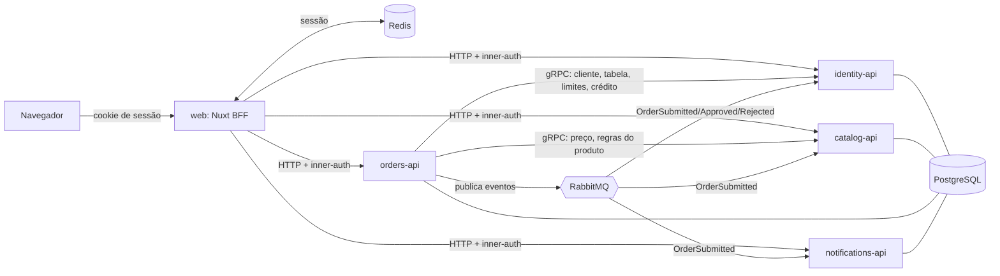

# Arquitetura

Visão geral da distribuição em serviços. As razões de cada escolha estão em [`DECISIONS.md`](DECISIONS.md) (D15 a D21).

## Visão geral

## Serviços

| Repositório (placeholder) | Responsabilidade | Schema | Fala com |
|---|---|---|---|
| `sales-web` | Nuxt: telas e BFF. Dono da sessão (Redis) e do cookie. Única porta de entrada do navegador | — | todos os serviços por HTTP |
| `sales-identity-api` | Supervisores, vendedores, clientes (carteira), tabela de preço do cliente (com fallback), limites de alçada e de crédito, crédito utilizado | `identity` | servidor gRPC; consome eventos de pedido |
| `sales-catalog-api` | Produtos, tabelas de preço, busca (`pg_trgm` + `unaccent`), regras de embalagem, flags de produtos indisponíveis | `catalog` | servidor gRPC; consome `OrderSubmitted` (estatística) |
| `sales-orders-api` | Todas as regras de pedido: cálculo, bloqueios, alçada, pedido mínimo, crédito, envio, aprovação, histórico, repetir pedido | `orders` | cliente gRPC de catalog e identity; publica eventos |
| `sales-notifications-api` | Avisos ao supervisor para pedidos aguardando aprovação | `notifications` | consome `OrderSubmitted` |
| `sales-contracts` | Arquivos `.proto` e esquemas de eventos | — | submódulo dos serviços |
| `sales-orchestration` (fase D) | Gráfico Helm guarda-chuva, subgráficos, cluster kind com Calico, ingress, NetworkPolicies, Docker Compose e guia de primeiros passos | — | todos os serviços (implantação) |
| `sales-platform` (guarda-chuva) | Documentos de entrega, `docker-compose.yml`, CI, submódulos | — | — |

Infraestrutura: um PostgreSQL (um schema e um papel por serviço, **sem consultas entre schemas**), RabbitMQ e Redis.

## Regras de comunicação

- **Navegador → web:** só o BFF recebe o navegador. Cookie de sessão; sessão no Redis.
- **BFF → serviços:** HTTP/JSON. Cada chamada leva um segredo interno (`x-inner-auth`) e o usuário e papel da sessão. Os serviços só aceitam chamadas com o segredo.
- **orders → catalog e identity:** gRPC, para as consultas que precisam estar corretas na hora (preço, regras de embalagem, cliente, tabela, limites, crédito disponível). Tanto o cálculo do pedido quanto o envio usam essas chamadas; as consultas são em lote para limitar o número de idas e voltas.
- **orders → identity, no envio:** `ReserveCredit` e `ReleaseCredit` (gRPC), para fechar a corrida de crédito. Ver "Reserva de crédito" abaixo.
- **Eventos (RabbitMQ, `@nestjs/microservices`):** só os eventos publicados por orders, em consumidores idempotentes. Exchange `orders.events` (topic), chaves `order.submitted`, `order.approved`, `order.rejected`; cada consumidor vincula a própria fila (`<serviço>-api-<evento>`). A carga chega envolvida como `{ pattern, data }`.
- **orders não guarda cópia de dados de outros serviços.** Guarda apenas o instantâneo (snapshot) do preço e do produto em cada item do pedido.

## Eventos

| Evento | Publicado por | Consumidores | O que fazem |
|---|---|---|---|
| `OrderSubmitted` | orders | identity | confirma a reserva de crédito do pedido (`PENDING` para `CONFIRMED`) |
| | | catalog | incrementa a estatística de produtos mais pedidos |
| | | notifications | cria aviso para o supervisor se o pedido aguarda aprovação |
| `OrderApproved` | orders | identity | mantém o crédito reservado |
| `OrderRejected` | orders | identity | libera o crédito (`RELEASED`) |

Todo consumidor é idempotente (chave: id do pedido).

## Reserva de crédito

O identity é dono do crédito. A tabela `credit_reservations` (schema `identity`) guarda, por pedido: `order_id` (chave primária), `client_id`, `amount_cents`, `status` (`PENDING`, `CONFIRMED`, `RELEASED`) e `expires_at`. O crédito comprometido de um cliente é calculado, não guardado em um contador:

> em uso = crédito já usado (do seed) + reservas `CONFIRMED` + reservas `PENDING` que ainda não expiraram
> disponível = limite − em uso

1. **Cálculo:** o orders consulta o cliente por gRPC e bloqueia com `CREDIT_EXCEEDED` se o total passar do disponível. É uma checagem de aviso, para a tela mostrar o motivo.
2. **Envio:** o orders chama `ReserveCredit(clientId, orderId, amount)`. Numa transação, o identity trava a linha do cliente (`SELECT ... FOR UPDATE`), soma o que está em uso e grava a reserva `PENDING` com `expires_at = agora + TTL`, ou recusa. Duas reservas do mesmo cliente são decididas uma depois da outra.
3. **Gravação:** o orders grava o pedido. Se falhar, chama `ReleaseCredit` (a reserva vira `RELEASED`).
4. **Confirmação:** `OrderSubmitted` torna a reserva `CONFIRMED`. Se a reserva já tinha expirado, ou nem existia, o consumidor a cria como `CONFIRMED`, então o crédito sempre reflete os pedidos que existem.
5. **Rejeição:** `OrderRejected` torna a reserva `RELEASED`; um evento repetido não a revive.
6. **Expiração sem tarefa agendada:** uma reserva `PENDING` simplesmente deixa de contar quando `expires_at` passa. Não há job.
7. **Repetição:** o mesmo `orderId` de novo devolve a reserva existente, sem reservar de novo.

Consumidores (identity): fila `identity-api-order-events`, do tipo *quorum*, com limite de entregas; uma mensagem que não bate com o esquema vai direto para `identity-api-order-events.dlq`; uma que falha é reentregue com espera crescente (0,5 s, 1 s, 2 s, 4 s, 8 s) e, esgotado o limite, o broker a move para a fila de mensagens mortas. Ver `DECISIONS.md` D40 a D42.

## Quem faz o quê nas regras

| Regra | Dono |
|---|---|
| Carteira (vendedor só vê seus clientes) | identity (filtro por vendedor da sessão) |
| Fallback da tabela de preço do cliente | identity |
| Preço por tabela, embalagem, busca, produtos indisponíveis | catalog |
| Totais, desconto, arredondamento, alçada, pedido mínimo, crédito, status, idempotência do envio | orders |
| Aprovação/rejeição pelo supervisor | orders (com permissão do papel vindo do BFF) |

## Sessão

1. A tela de entrada lista vendedores e o supervisor (via BFF → identity).
2. Ao escolher, o BFF pede a identity para validar a escolha, cria a sessão no Redis e devolve o cookie.
3. A cada requisição, o BFF lê a sessão e repassa usuário e papel aos serviços.

## Semente (`seed.json`)

Cada serviço importa sua parte na inicialização, de forma idempotente: identity (supervisores, vendedores, clientes), catalog (produtos, tabelas), orders (pedidos do histórico).

## Fases

- **A:** identity, catalog, orders, web; RabbitMQ e Redis já no compose.
- **B:** crédito (consumidor em identity), histórico e repetir pedido, aprovação do supervisor, notifications.
- **C:** pedido offline com sincronização.
- **D:** repositório `orchestration` (Helm, kind, ingress, NetworkPolicies, guia de primeiros passos). O `docker-compose.yml` passa a morar nele; o repositório raiz mantém um arquivo fino com `include:` para que `docker compose up` continue funcionando. Ver `DECISIONS.md` D29.
