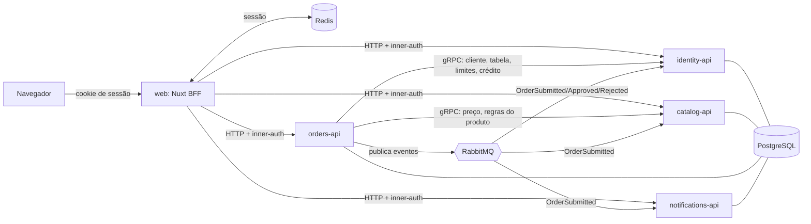

# Arquitetura

Visão geral da distribuição em serviços. As razões de cada escolha estão em [`DECISIONS.md`](DECISIONS.md) (D15 a D21).

## Visão geral

## Serviços

| Repositório (placeholder) | Responsabilidade | Schema | Fala com |
|---|---|---|---|
| `sales-web` | Nuxt: telas e BFF. Dono da sessão (Redis) e do cookie. Única porta de entrada do navegador | — | todos os serviços por HTTP |
| `sales-identity-api` | Supervisores, vendedores, clientes (carteira), tabela de preço do cliente (com fallback), limites de alçada e de crédito, crédito utilizado | `identity` | servidor gRPC; consome eventos de pedido |
| `sales-catalog-api` | Produtos, tabelas de preço, busca (`pg_trgm` + `unaccent`), regras de embalagem, flags de produtos indisponíveis | `catalog` | servidor gRPC; consome `OrderSubmitted` (estatística) |
| `sales-orders-api` | Todas as regras de pedido: cálculo, bloqueios, alçada, pedido mínimo, crédito, envio, aprovação, histórico, repetir pedido | `orders` | cliente gRPC de catalog e identity; publica eventos |
| `sales-notifications-api` | Avisos ao supervisor para pedidos aguardando aprovação | `notifications` | consome `OrderSubmitted` |
| `sales-contracts` | Arquivos `.proto` e esquemas de eventos | — | submódulo dos serviços |
| `sales-platform` (guarda-chuva) | Documentos de entrega, `docker-compose.yml`, CI, submódulos | — | — |

Infraestrutura: um PostgreSQL (um schema e um papel por serviço, **sem consultas entre schemas**), RabbitMQ e Redis.

## Regras de comunicação

- **Navegador → web:** só o BFF recebe o navegador. Cookie de sessão; sessão no Redis.
- **BFF → serviços:** HTTP/JSON. Cada chamada leva um segredo interno (`x-inner-auth`) e o usuário e papel da sessão. Os serviços só aceitam chamadas com o segredo.
- **orders → catalog e identity:** gRPC, para as consultas que precisam estar corretas na hora (preço, regras de embalagem, cliente, tabela, limites, crédito disponível). Tanto o cálculo do pedido quanto o envio usam essas chamadas; as consultas são em lote para limitar o número de idas e voltas.
- **orders → identity, no envio:** `ReserveCredit` e `ReleaseCredit` (gRPC), para fechar a corrida de crédito. Ver "Reserva de crédito" abaixo.
- **Eventos (RabbitMQ, `@nestjs/microservices`):** só os eventos publicados por orders, em consumidores idempotentes.
- **orders não guarda cópia de dados de outros serviços.** Guarda apenas o instantâneo (snapshot) do preço e do produto em cada item do pedido.

## Eventos

| Evento | Publicado por | Consumidores | O que fazem |
|---|---|---|---|
| `OrderSubmitted` | orders | identity | confirma a reserva de crédito do pedido (de `pendente` para `confirmada`) |
| | | catalog | incrementa a estatística de produtos mais pedidos |
| | | notifications | cria aviso para o supervisor se o pedido aguarda aprovação |
| `OrderApproved` | orders | identity | mantém o crédito reservado |
| `OrderRejected` | orders | identity | libera o crédito reservado |

Todo consumidor é idempotente (chave: id do pedido).

## Reserva de crédito

O identity é dono do crédito. Na tabela `credit_reservations` (schema `identity`) cada reserva tem `order_id` (chave primária), `client_id`, `amount` e `status` (`pendente`, `confirmada`, `liberada`).

1. **Envio:** o orders gera o id do pedido e chama `ReserveCredit(clientId, orderId, amount)`.
2. **Reserva atômica:** numa única transação o identity insere a reserva (a chave primária torna repetições idempotentes) e executa `UPDATE ... SET credit_used = credit_used + :amount WHERE limit_credit - credit_used >= :amount`. Zero linhas atualizadas significa crédito insuficiente e a reserva não é criada. Duas submissões simultâneas não passam juntas.
3. **Gravação:** o orders grava o pedido. Se a gravação falhar, chama `ReleaseCredit` (melhor esforço).
4. **Confirmação:** o orders publica `OrderSubmitted`; o identity marca a reserva como `confirmada`.
5. **Rejeição:** `OrderRejected` libera a reserva (devolve o valor ao crédito disponível).
6. **Limpeza:** um job no identity libera reservas `pendente` com mais de 15 minutos. Cobre a queda entre os passos 2 e 4.
7. **Repetição:** repetir o envio com o mesmo id de pedido reaproveita a reserva existente e conclui a gravação.

Limitação conhecida: se o evento `OrderSubmitted` atrasar mais que o prazo de limpeza (por exemplo, com o RabbitMQ parado), uma reserva de pedido válido pode ser liberada indevidamente. A mitigação é um outbox transacional no orders, descrito como melhoria em `DECISIONS.md` D22.

## Quem faz o quê nas regras

| Regra | Dono |
|---|---|
| Carteira (vendedor só vê seus clientes) | identity (filtro por vendedor da sessão) |
| Fallback da tabela de preço do cliente | identity |
| Preço por tabela, embalagem, busca, produtos indisponíveis | catalog |
| Totais, desconto, arredondamento, alçada, pedido mínimo, crédito, status, idempotência do envio | orders |
| Aprovação/rejeição pelo supervisor | orders (com permissão do papel vindo do BFF) |

## Sessão

1. A tela de entrada lista vendedores e o supervisor (via BFF → identity).
2. Ao escolher, o BFF pede a identity para validar a escolha, cria a sessão no Redis e devolve o cookie.
3. A cada requisição, o BFF lê a sessão e repassa usuário e papel aos serviços.

## Semente (`seed.json`)

Cada serviço importa sua parte na inicialização, de forma idempotente: identity (supervisores, vendedores, clientes), catalog (produtos, tabelas), orders (pedidos do histórico).

## Fases

- **A:** identity, catalog, orders, web; RabbitMQ e Redis já no compose.
- **B:** crédito (consumidor em identity), histórico e repetir pedido, aprovação do supervisor, notifications.
- **C:** pedido offline com sincronização.
