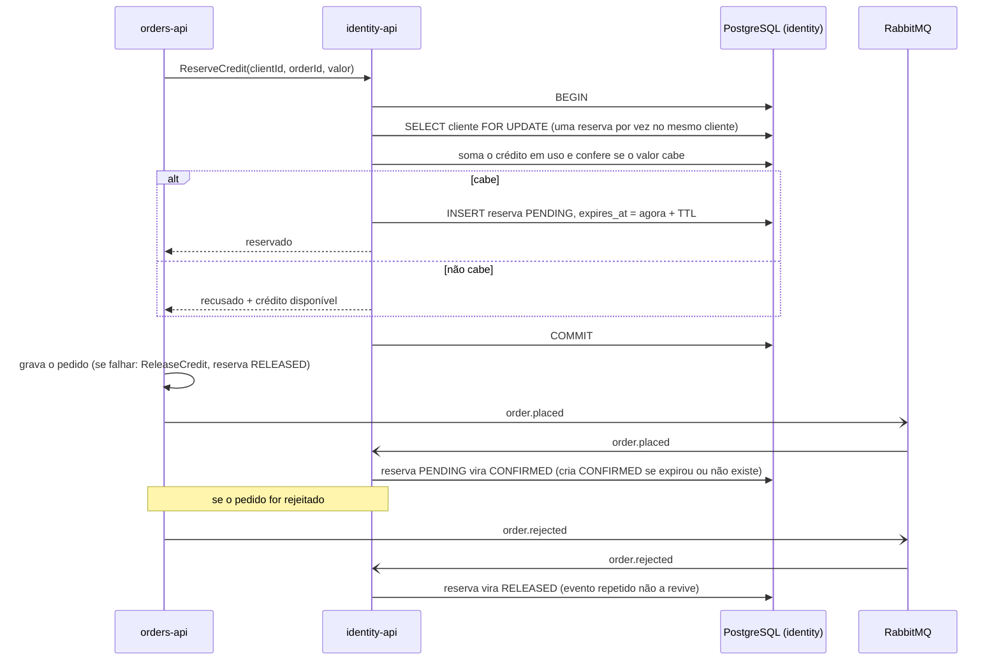

# Reserva de crédito

O crédito é do `identity`. O `orders` reserva no envio, de forma atômica, e o evento confirma ou libera. O crédito em uso é **calculado** (já usado + reservas `CONFIRMED` + reservas `PENDING` que não expiraram), então uma reserva sem confirmação some sozinha quando `expires_at` passa, sem tarefa agendada.

Referenciado em `../architecture/ARCHITECTURE.md` §5.
