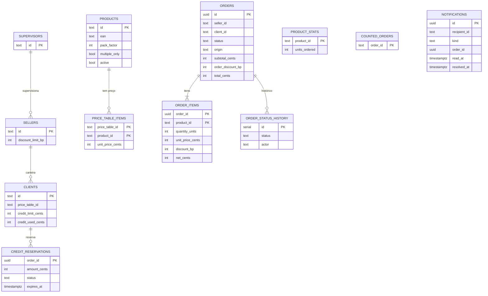

# Dono dos dados

Cada serviço é dono de um schema do PostgreSQL e de um papel (`<serviço>_role`) que só enxerga esse schema; não existe consulta entre schemas nem chave estrangeira entre serviços. O `orders` não guarda cópia de dados dos outros: cada item do pedido leva só o instantâneo (descrição, SKU, preço) do momento do envio. O diagrama mostra as tabelas principais e as relações **dentro** de cada schema.

Por schema:

| Schema | Tabelas |
|---|---|
| `identity` | `supervisors`, `sellers`, `clients`, `credit_reservations` |
| `catalog` | `products`, `price_tables` (só `id` e nome, fora do desenho), `price_table_items`, `product_stats`, `counted_orders` |
| `orders` | `orders`, `order_items`, `order_status_history` |
| `notifications` | `notifications` (a combinação `order_id`, `recipient_id`, `kind` é única) |

`product_stats` não tem chave estrangeira para `products` de propósito (DECISIONS D53). Referenciado em `../architecture/ARCHITECTURE.md` §2.
