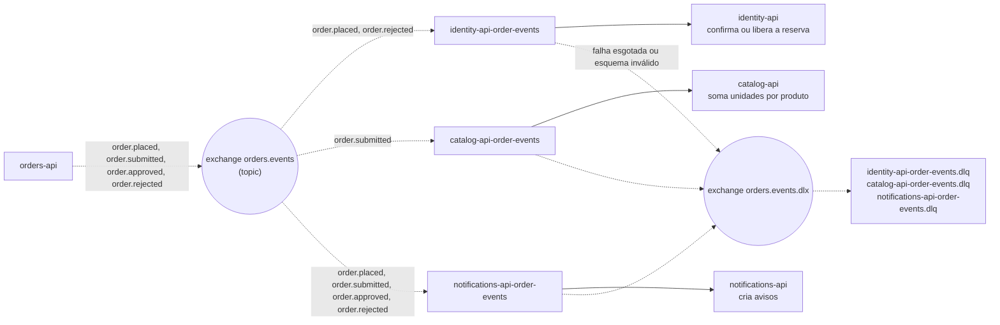

# Eventos e filas

O `orders` publica quatro eventos no exchange `orders.events` (tipo topic). Cada consumidor tem a fila própria, do tipo *quorum*, com limite de entregas, e uma fila de mensagens mortas (`.dlq`) ligada ao exchange `orders.events.dlx`. Uma mensagem que não bate com o esquema vai direto para a `.dlq`; uma que falha é reentregue com espera crescente até esgotar o limite.

Todo consumidor é idempotente: identity pela reserva do pedido, catalog por `counted_orders` (uma transação com a soma), notifications por (pedido, pessoa, tipo). A publicação não usa outbox. Referenciado em `../architecture/ARCHITECTURE.md` §6.
