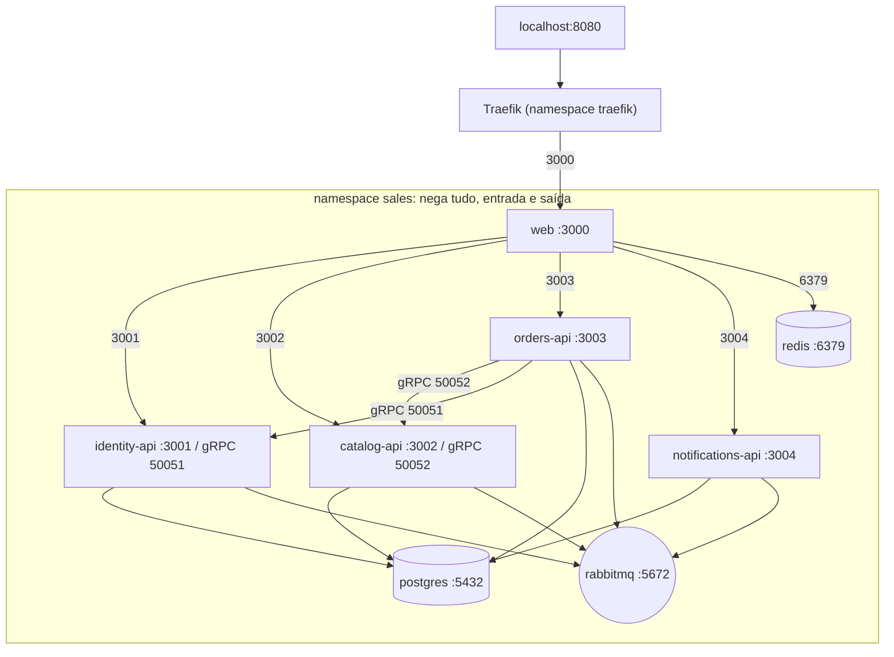

# Implantação em Kubernetes

O mesmo sistema num cluster kind de um nó. O namespace `sales` nega todo o tráfego, nos dois sentidos; cada carga abre só os caminhos listados (o DNS sai sempre). Só o `web` é alcançável de fora, pelo ingress.

Qualquer outro caminho (por exemplo `web` para `postgres`, ou `catalog-api` para `orders-api`) é bloqueado; `scripts/verify.sh` prova isso abrindo conexões de dentro dos pods. Referenciado em `../architecture/ARCHITECTURE.md` §10.
