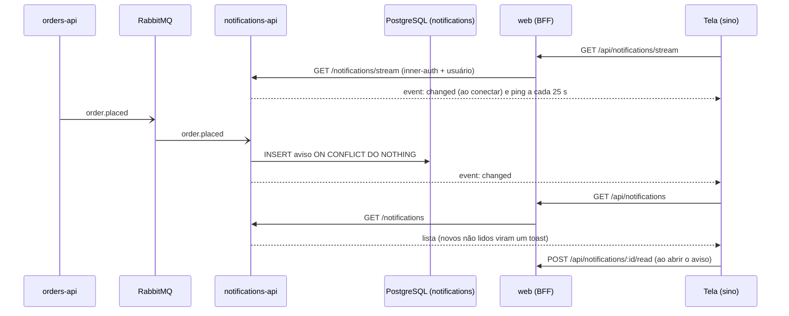

# Avisos em tempo real

Um evento de pedido vira um aviso no banco e, em seguida, um sinal `changed` para quem está com a tela aberta. O fluxo SSE **não carrega o conteúdo**: a tela pede a lista de novo, então perder um sinal custa uma leitura a mais, nunca um aviso perdido.

O difusor mora no processo do `notifications` (limite conhecido: uma réplica). Referenciado em `../architecture/ARCHITECTURE.md` §7.
