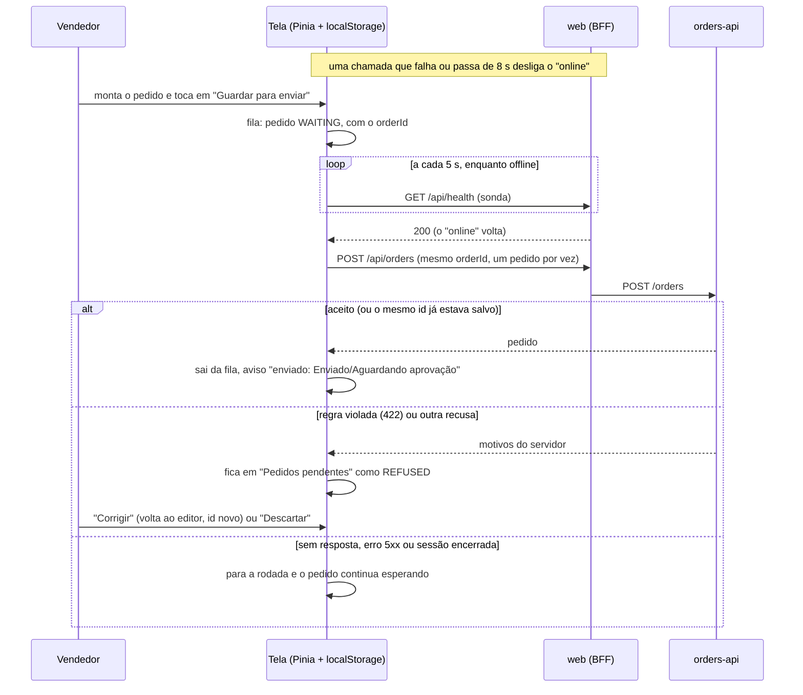

# Pedido sem sinal

Sem resposta do servidor, a tela não calcula nem busca: mostra o último cálculo marcado como desatualizado e procura só entre os produtos já vistos. "Guardar para enviar" põe o pedido na fila do navegador, com o mesmo `orderId` com que ele será enviado. Quando o servidor volta a responder, a fila é enviada, e o servidor confere todas as regras de novo.

Os pedidos guardados pertencem ao vendedor que os fez. Referenciado em `../architecture/ARCHITECTURE.md` §9.
