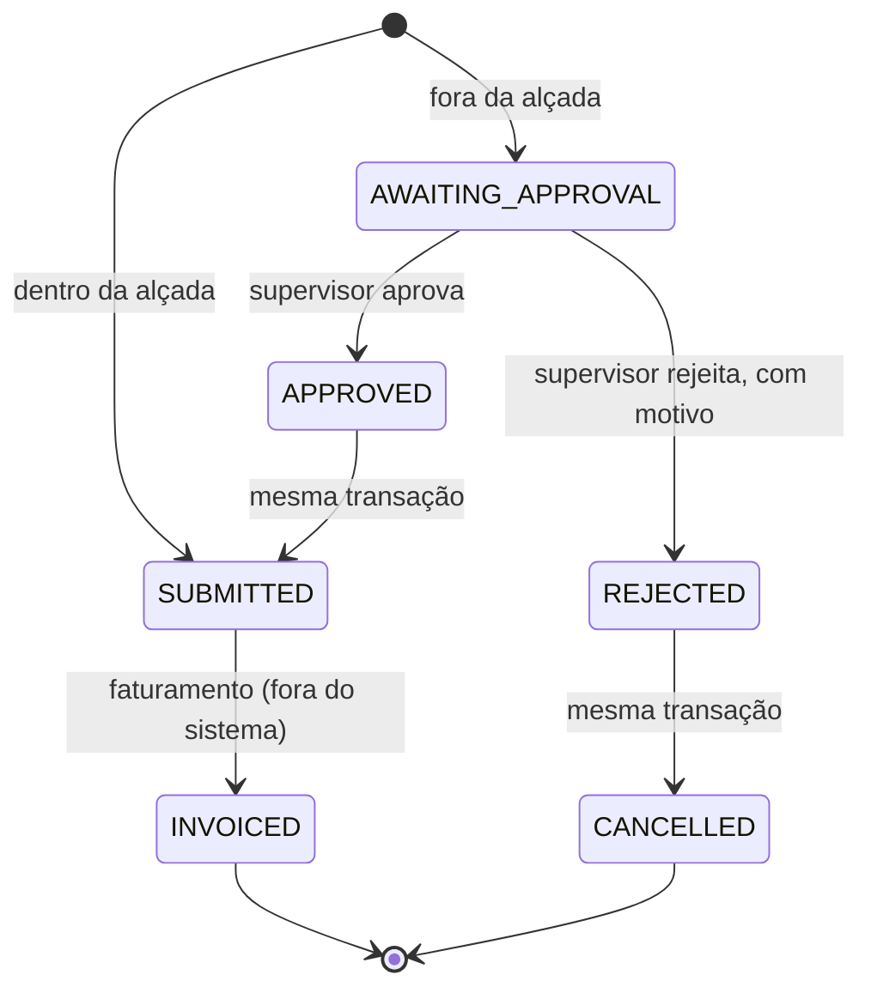

# Ciclo de vida do pedido

Seis status, em duas cadeias. Dentro da alçada o pedido já nasce `SUBMITTED`; fora dela nasce `AWAITING_APPROVAL`. A decisão do supervisor leva o pedido por dois degraus de uma vez, na mesma transação, e `order_status_history` guarda cada passo. `INVOICED` seria posto por um faturamento que não existe aqui: só os pedidos importados do seed o têm.

O `INVOICED` existe para guardar o "Faturado" do seed: nenhum pedido novo chega a ele, e o pedido novo descansa em `SUBMITTED`. Na tela: Enviado (`SUBMITTED`), Aguardando aprovação, Aprovado, Rejeitado, Faturado, Cancelado. Referenciado em `../architecture/ARCHITECTURE.md` §4.
