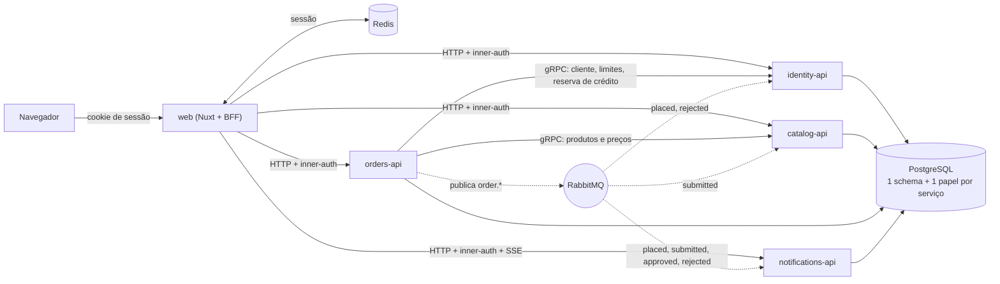

# Topologia dos serviços

Quem fala com quem. O navegador só conhece o `web` (Nuxt, que também é o BFF). O `web` chama os quatro serviços por HTTP com o segredo interno; o `orders` consulta `catalog` e `identity` por gRPC e é o único que publica eventos no RabbitMQ. Cada serviço grava só no próprio schema do PostgreSQL.

Linhas tracejadas são assíncronas (eventos). Referenciado em `../architecture/ARCHITECTURE.md` §1.
