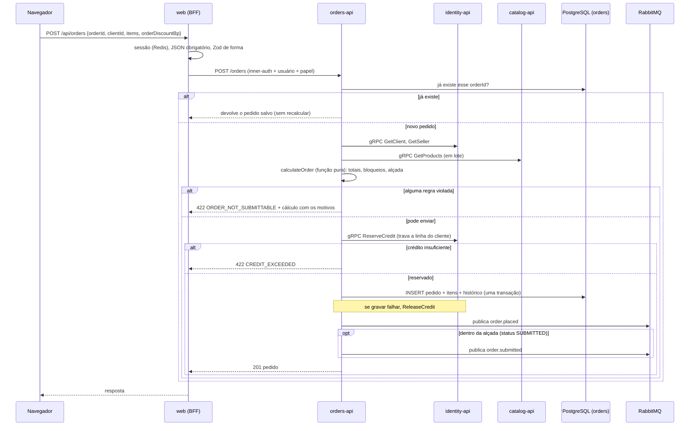

# Envio de um pedido

O caminho de `POST /api/orders`, na ordem em que acontece em `OrdersService.submit`. A reserva de crédito vem **antes** de gravar o pedido; se gravar falhar, o crédito é devolvido. Os eventos saem depois da gravação.

Referenciado em `../architecture/ARCHITECTURE.md` §3.
